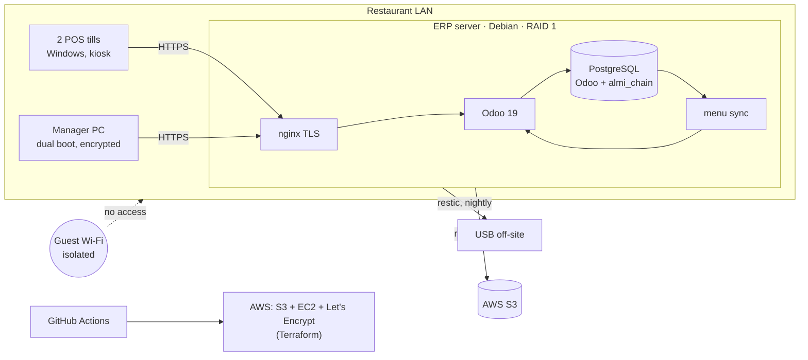

# Almi-Chain · IT for a restaurant chain

[](https://github.com/zHGx-alt/Almi-Chain/actions/workflows/ci.yml)
[](https://github.com/zHGx-alt/Almi-Chain/actions/workflows/gitleaks.yml)

The complete IT setup for a new restaurant in a Basque chain: network, servers, ERP and point of sale, the chain's own database, backups, cloud hosting for the website, and even the arcade machine in the dining room. Built by **a team of 6 in 4 weeks**.

**Live website:** <https://zhgx-alt.github.io/Almi-Chain/>



## Highlights

| | What it shows | Stack |
|---|---|---|
| [**Database**](database/) | 3NF model with 17 tables, rules enforced by triggers, least-privilege roles, 49 + 18 automated tests | PostgreSQL, PL/pgSQL |
| [**Data sync**](data-sync/) | Idempotent sync from the chain's database to the Odoo POS, with dry run and a read-only role; CSV import that validates everything before writing | Python stdlib, XML-RPC, Docker Compose |
| [**ERP**](erp/) | Odoo with Docker behind an nginx TLS proxy, configured with no clicks, plus an end-to-end automated invoice | Odoo, Docker, nginx, Python |
| [**Backup & recovery**](backup/) | RAID 1 and an encrypted 3-2-1 backup with alerting, an isolated restore test, and recovery on a blank machine measured at **RTO 14 min** | mdadm, restic, systemd, S3 |
| [**Cloud & IaC**](cloud/) | The website on AWS with Terraform: private S3, hardened EC2, HTTPS and strict security headers | Terraform, AWS, GitHub Actions |
| [**Network & security**](network-security/) | Network design, hardened server and tills, an nmap suite with automatic verdicts, and a 26-finding security review | Packet Tracer, ufw, PowerShell, nmap |

Also built: the website, an arcade machine on 1 core and 1 GB, a USB arcade stick with unit-tested firmware, a dual-boot encrypted office PC, Wi-Fi extension over WDS and the hardware budget → [`also-built/`](also-built/).

## Try it

```bash
docker compose up --build --abort-on-container-exit --exit-code-from sync
```

This builds the database and runs every test, starts a stand-in for Odoo's API, and syncs the menu twice. The second run must change nothing:

```text
db-1    | Constraint tests: 49/49 OK
db-1    | Database ready: 49/49 constraint tests, 9/9 + 9/9 user tests
sync-1  | Sync: 0 new, 12 updated, 0 unchanged.
sync-1  | Sync: 0 new, 0 updated, 12 unchanged.
sync-1  | Demo OK: the second run changed nothing.
```

To run it again from scratch, first `docker compose down -v`: the database tests only run when the database is created. No Docker? `bash database/test-local.sh` and `bash data-sync/test_sync.sh` do the same against a local PostgreSQL.

## Known limits

- The Odoo in the demo is a fake that implements only the API calls the scripts use. The real deployment scripts are in [`erp/`](erp/).
- Most of the infrastructure was built and tested in virtual machines. HTTPS on the team's physical server and the measured Wi-Fi coverage of the second router were not finished.
- The AWS environment (AWS Learner Lab) only runs during lab sessions, so the always-on copy of the website is on GitHub Pages.
