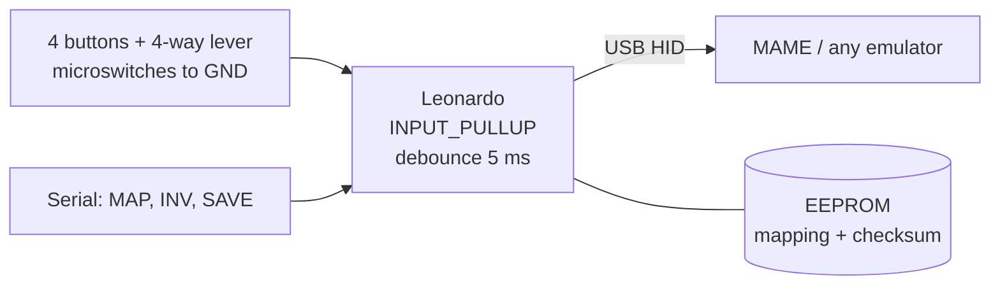

# Also built

The rest of the project, one line each. The code is here; the write-ups stay short on purpose.

| Piece | What it is | Code |
|---|---|---|
| **Restaurant website** | Static HTML/CSS/JS: responsive, accessible (skip link, ARIA, WCAG AA contrast), with a dish slideshow, opt-in geolocation that shows the distance to the restaurant, a map loaded on demand and a demo contact form. No third-party scripts, so it runs under a strict CSP. Live on GitHub Pages. | [`web/`](web/) |
| **Arcade machine** | Debian 13 with no desktop that boots straight into MAME as a locked-down user. A tuning script moves updates to 05:00 and trims timers and disk use without turning off security. It runs on **1 core and 1 GB RAM**: the benchmark games run at 7-10× real speed, from power-on to MAME in 16 s. A POSIX-sh monitor records CPU, memory and temperature to CSV while people play. | [`arcade/`](arcade/) |
| **Arcade stick** | Arduino Leonardo firmware that shows up as a standard USB HID joystick with no drivers. Buttons can be remapped over the serial port and saved to EEPROM with a checksum. Debouncing runs without `delay()`, with 5-6 ms latency. The firmware is **unit-tested on the PC** by compiling the real `.ino` against Arduino stand-ins and simulating contact bounce (runs in CI). | [`arcade-stick/`](arcade-stick/) |
| **Manager's dual-boot PC** | Windows 10 + Ubuntu: BitLocker without a TPM (boot password, recovery key never printed), `/home` encrypted with fscrypt and unlocked by the login password, and unneeded services disabled on both systems with a before/after report. | [`dual-boot/`](dual-boot/) |
| **Wi-Fi extension (WDS)** | A second router linked by radio to the first, on the same LAN with a single DHCP server, to cover the dining room. Tested: link, single DHCP, ping and Internet through the second router. | [network design](../network-security/) |
| **Receipt printer** | USB to its till, so it has no IP and no attack surface. Odoo renders the receipt in the kiosk browser and Windows prints it. | [POS hardening](../network-security/hardening/pos-hardening.ps1) |
| **Hardware budget** | Every device with model, quantity and price, plus the first-year cost (about 4,250 €). | [`hardware-budget.md`](hardware-budget.md) |

### Arcade stick in short



```text
OK    press with 3 ms bounce on close and open: counts 1, not 5
OK    1 and 2 ms noise spikes: no press
OK    a clean press arrives in 5-6 ms
OK    remap with the button held: HID 1 released and HID 2 pressed
OK    at rest, one report every 100 ms
```

Wiring: [`wiring.svg`](arcade-stick/wiring.svg). Live input check on Linux: [`watch_stick.py`](arcade-stick/watch_stick.py).
