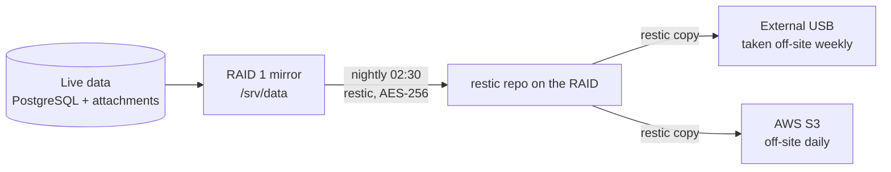

# Backup and recovery: RAID 1, 3-2-1 with restic, tested restore



- **Redundant storage** ([`raid1/`](raid1/)): an mdadm mirror that refuses to touch disks with data or the system disk. Docker's volumes are bind-mounted on it, and Docker is ordered after the mount, so Odoo can never start on an empty database. [`simulate-disk-failure.sh`](raid1/simulate-disk-failure.sh) fails a disk while Odoo keeps taking sales, then rebuilds the mirror.
- **3-2-1** ([`restic/`](restic/)): consistent `pg_dump` of both databases plus attachments and config, encrypted and deduplicated, kept 7 daily, 4 weekly and 6 monthly. Every copy runs `restic check`. A systemd timer (`Persistent=true`) catches up after power-offs. If the off-site copy is older than 7 days, the service fails and `OnFailure=` alerts through the journal, `wall` and, optionally, email.
- **Restore test** ([`restore/test-restore.sh`](restore/test-restore.sh)): restores into an isolated Docker network, compares 20+ figures against production (row counts, invoice totals, attachment hashes, grants), logs in to the restored Odoo and cleans up.
- **Disaster recovery** ([`restore/recover-new-server.sh`](restore/recover-new-server.sh)): from a blank machine and the USB disk to Odoo over HTTPS with the backed-up data.

**Measured recovery on a new VM:**

```text
Create the VM and install Debian 13 (preseed)          468 s
Plug in the USB disk                                     41 s
Install restic, Docker and Compose                       73 s
Restore both databases + attachments, start with HTTPS  250 s
RTO                                                     832 s  ≈ 14 min
RPO (worst case, nightly backup)                         24 h
```

Most of the time goes into installing Debian and pulling Docker images. Without Internet on site, the images would travel on the USB disk too (`docker save`).
