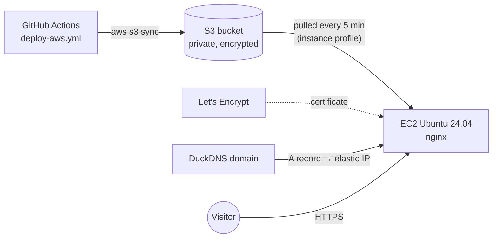

# Cloud: the restaurant's website on AWS with Terraform



**What Terraform builds** ([`terraform/`](terraform/)):
- **S3**: public access blocked, ACLs disabled and server-side encryption on. Terraform also does the first upload of the site.
- **Security group**: 80 and 443 open; SSH only from the network given in `ssh_cidr` (our own IP as a `/32`), and a variable `validation` rejects `0.0.0.0/0`.
- **EC2**: IMDSv2 required, encrypted gp3 root volume, and an elastic IP created first so that `user_data` can wait for it.
- **First boot**: `user_data` points DuckDNS at the IP, waits for DNS, then runs [`install-web-server.sh`](install-web-server.sh), which installs nginx and certbot, sets HTTP→HTTPS and strict security headers (CSP, HSTS, Permissions-Policy) and adds a cron job that syncs from S3.

Secrets never touch the repo: AWS credentials come from the environment, the DuckDNS token from `TF_VAR_duckdns_token`, and `terraform.tfvars` is git-ignored.

**Run it** (with AWS credentials in the environment):

```bash
cp terraform/terraform.tfvars.example terraform/terraform.tfvars   # set email and ssh_cidr
terraform -chdir=terraform init && terraform -chdir=terraform apply
```

CI runs `terraform fmt -check` and `terraform validate` on every push. The live copy of the site is on GitHub Pages, because the AWS environment used for the project (AWS Learner Lab) only runs while a lab session is open.

Some choices are workarounds for that lab: the bucket is read as a `data` source because the lab blocks an S3 call that `aws_s3_bucket` always makes, and the instance uses the lab's `LabInstanceProfile` because roles cannot be created there.
