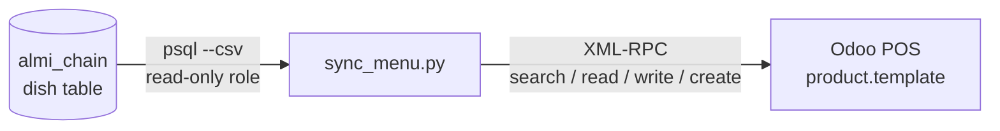

# Data sync: chain database → Odoo POS

The chain's own database is the source of truth for the menu. [`sync_menu.py`](sync_menu.py) reads it and writes it to the Odoo point of sale through Odoo's XML-RPC API, using only the Python standard library and `psql`.



| almi_chain `dish` | Odoo `product.template` |
|---|---|
| `dish_id` | `default_code` = `ALMI-<dish_id>` (the link between both systems) |
| `price` + `vat_rate` | `list_price` with VAT included, rounded to 2 decimals |
| `description` | `description_sale` |
| `name`, `category` | `name`, `pos_categ_ids` (only when the product is created) |

- **Idempotent**: products are found by their `ALMI-<id>` reference, so re-running never duplicates anything. On the first run, a product with the same name and no reference gets linked instead of duplicated.
- **Safe to preview**: `--dry-run` reports what would change and writes nothing.
- **Least privilege**: it reads with the `reporting` account, which cannot modify the database.
- **CSV import** ([`csv/import_export.py`](csv/import_export.py)): every row is validated before anything is written (columns, prices). One bad row means nothing is imported, and every error is listed with its line number.

**Run it**: `docker compose up --build --abort-on-container-exit --exit-code-from sync` from the repo root. The demo syncs twice, and the second run must change nothing:

```text
sync-1  | Sync: 0 new, 12 updated, 0 unchanged.
sync-1  | Sync: 0 new, 0 updated, 12 unchanged.
sync-1  | Demo OK: the second run changed nothing.
```

> The Odoo in the demo is [`fake_odoo`](fake_odoo/fake_odoo.py): an in-memory server that implements only the calls these scripts make, and returns an error for anything else. It is not a real Odoo; the real deployment is in [`erp/`](../erp/).

Tests: unit tests for `fake_odoo` and the CSV import, and [`test_sync.sh`](test_sync.sh), which runs the sync end to end on a throwaway PostgreSQL (dry run, first link, idempotence, a price change, a new dish).
