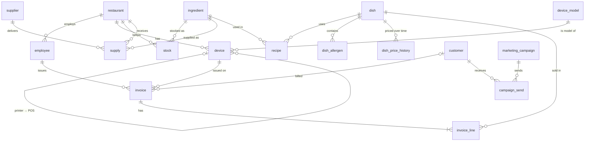

# Database

One central PostgreSQL database for the whole chain, with each restaurant's rows separated by `restaurant_id`. The model is in 3NF: 17 tables plus a view for invoice totals, so totals are computed and never stored twice.



**Rules enforced by triggers** ([`02-rules.sql`](schema/02-rules.sql)): invoices only from a POS (R-02) by staff of the same restaurant (R-01); receipt printers attached to a POS of their own restaurant (R-03); gap-free numbering per series with an advisory lock (R-05); every sale deducts the recipe's ingredients from stock and is rejected if stock runs out (R-06); every price change closes and opens a price-history period (R-07).

**Least privilege** ([`03-roles.sql`](schema/03-roles.sql), [`08-users.sql`](schema/08-users.sql)): `pos_app` can sell but never update or delete an issued invoice (R-04) or touch configuration; `reporting` is read-only. Passwords are passed at run time, never stored.

**Tests**: 49 constraint tests ([`05`](tests/05-constraint-tests.sql)) and 9 + 9 per-account privilege tests ([`09`](tests/09-user-tests.sql)), all inside transactions that roll back. Fifteen business queries are in [`07-queries.sql`](queries/07-queries.sql), for example:

```text
Q-04 Top 5 dishes                              Q-08 Below minimum stock
 name               | category | units          restaurant        | ingredient | quantity | min
--------------------+----------+-------         ------------------+------------+----------+-----
 Caña               | drink    |    14          Almi-Chain Abando | Beef chop  |    1.000 | 3.000
 Gilda              | starter  |    12
 Café               | drink    |     9
```

**Run it**: `bash database/test-local.sh` with a local PostgreSQL, or `docker compose up db` from the repo root (the tests run when the container is first created; `docker compose down -v` starts over). The run prints:

```text
Database ready: 49/49 constraint tests, 9/9 + 9/9 user tests
```
