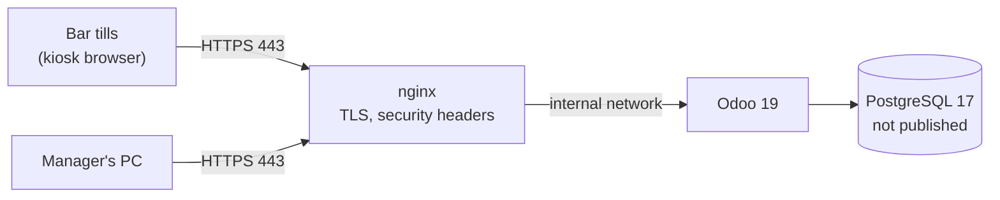

# ERP: Odoo on Docker with HTTPS

**Why Odoo Community:** it covers invoicing, CRM, staff, marketing and inventory, plus a touch POS with a restaurant mode, all in one free edition. It has an official Spanish localisation (VAT, chart of accounts) and a full XML-RPC API. We also compared ERPNext (heavier to run: MariaDB, Redis and several services; taxes set up by hand) and Dolibarr (lighter, but a more basic POS and a thinner API).



- [`deploy-odoo.sh`](deploy-odoo.sh) installs Docker on a headless Debian 13, generates every secret at random into a `.env` with mode 600, locks down `odoo.conf` (no database manager, `dbfilter` to one database) and creates the database without demo data. It is idempotent.
- [`https/enable-https.sh`](https/enable-https.sh) puts nginx in front of Odoo. The certificate has `nameConstraints`, so a stolen key cannot sign certificates for other sites. HTTP redirects to HTTPS, the session cookie is `secure`-only, and Odoo stops listening on the LAN.
- [`setup/`](setup/): configures the company, modules, two restaurant-mode tills and least-privilege users (cashiers see only the POS) through the API, with no clicks.

**Automated use case** ([`automation/auto_invoice.py`](automation/auto_invoice.py)): a company books a group lunch and needs a full invoice. The script goes customer → product → sales order → posted invoice → payment → PDF, and checks that the total matches the expected VAT:

```text
[1/6] Customer: Test customer (id 10)
[2/6] Product: Arcade game at 2.50 EUR + VAT 21% S (id 6)
[3/6] Order S00003 confirmed (sale), total 12.10 EUR
[4/6] Invoice INV/2026/00001 posted on 2026-10-22: base 10.00 EUR + VAT 2.10 EUR = 12.10 EUR
[5/6] Payment registered: payment state 'paid'
[6/6] PDF saved to INV_2026_00001.pdf (24 KB)
```

Menu data comes from the chain's database through [`data-sync/`](../data-sync/).
