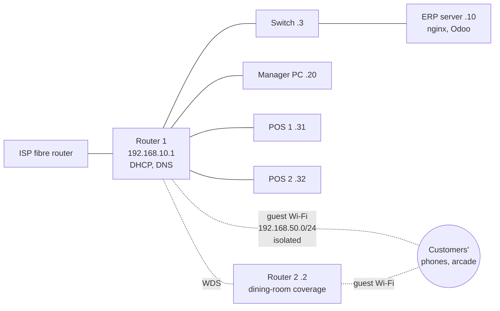

# Network and security

| Range in 192.168.10.0/24 | Use |
|---|---|
| .1–.3 | Routers and switch |
| .10–.19 / .20–.29 / .30–.39 | Servers / management / POS (DHCP reservations) |
| .100–.199 | Dynamic DHCP for staff devices |

The network was first designed and tested in Cisco Packet Tracer: 16 of 16 connectivity tests passed, including guests being unable to reach the LAN. The staff network is flat, with no VLANs on consumer routers, so every machine protects itself:

- **Wi-Fi**: WPA2/WPA3, the guest network isolated from the LAN and from other clients, router admin only from the LAN, default credentials changed.
- **Server** ([`hardening/`](hardening/)): unattended Debian install with SSH key-only (no password, no root) and `unattended-upgrades` from the first boot. `ufw` allows SSH only from the manager's PC and HTTPS only from the LAN. Odoo and PostgreSQL are never published.
- **POS terminals** ([`pos-hardening.ps1`](hardening/pos-hardening.ps1)): standard cashier account that cannot elevate, USB storage blocked, outbound firewall allowlist (Odoo, DNS, DHCP, NTP, updates), Edge restricted to the POS URL, kiosk mode. [`pos-check.ps1`](hardening/pos-check.ps1) re-checks 16 items read-only.
- **Verification** ([`scan-network.sh`](network/scan-network.sh)): an nmap suite with automatic OK / CHECK verdicts, run from the LAN and from the guest Wi-Fi. Expected results: the server exposes only 22, 80 and 443; TLS 1.2 and 1.3 only; POS terminals expose nothing; from the guest network no LAN host is visible.

**Security review**: a cross-cutting review of every script and configuration found 26 issues (6 high, 10 medium, 10 low), each with an owner. Fixed, among others: an unconstrained CA certificate (now `nameConstraints`), Wi-Fi passwords visible in screenshots, the router admin panel, SSH password login and missing automatic updates. Left open and documented: HTTPS on the team's physical server (tested in a VM only), the router's UPnP and old firmware, and Windows 10 end of support on the tills.

The repository itself is guarded too: gitleaks in CI and in a pre-commit hook, and secrets only in git-ignored `.env` / `tfvars` files.
